# AVA Castles of Dr. Creep

[](https://github.com/Harlock123/AVACastlesOfDrCreep/actions/workflows/build.yml)

A puzzle-platform game in the style of Ed Hobbs's 1984 Commodore 64 classic **The Castles of Dr. Creep**,
built with .NET 10 and Avalonia UI. A voice welcomes you in, and then you have to find your way out. Each
castle is a set of single-screen rooms joined by doors, full of machines, traps and monsters. Nearly every
hazard has a control box somewhere in its room. Learn what each control does and you can turn the castle's
traps on its monsters. Play alone, or with two players at once.

## Features

- **Five castles**, chosen from the title screen: the **Tutorial**, **Ravenmoor**, **Grimwald**,
  **Mortlake** and **Blackspire**. They range from five easy rooms to six hard ones. Start at any castle;
  escaping one takes you into the next.
- **Getting about:** walk the floors, climb ladders up and down, slide down poles. Go up at a door to go
  through it, and the matching door on the other side opens too. Walk off a ledge and you fall. More than a
  few squares is fatal.
- **The machines, and their controls:**
  - **Doorbells** open shut doors. **Coloured keys** open the locks of their colour.
  - **Trapdoors** open and shut from a lever. Anyone (or anything) on one when it opens drops through.
  - **Moving walkways** carry whoever stands on them. Their control stops them and sends them back the
    other way.
  - **Force fields** stop players and monsters alike. Their button drops a field for six seconds.
  - **Lightning machines** kill whatever walks into them. A switch turns each one on and off.
  - **Ray guns** slide up and down their rails, find your height, and fire across the room. From the
    gun's control it's yours to move and fire, and it won't fire on you.
  - **Matter transmitters**: the button picks a receiver by colour, and up sends you there.
- **The monsters:**
  - **Mummies** rise from their tombs when you touch the ankh, and walk their floor after you. They
    can't climb.
  - **The monster** stands in its coffin until you pass on the same floor. Then it follows you anywhere
    you can go, by ladder and pole too, though more slowly.
  - Both stop at force fields, and lightning, the ray guns and an open trapdoor finish them (500 each).
- **The map** (Tab, or Back on a gamepad) shows the rooms found so far, the doors between them, and where
  everyone is.
- **Two players** play at once with their own keys or gamepads. When they're in different rooms, the screen
  shows both rooms side by side. Each has three lives, and a lost life starts you again at the door you
  last came in by. The castle is escaped when everyone still in the game is out.
- **Times and points:** the clock runs from the moment you're in. Your **best time** for each castle is
  kept and shown on the title screen. Escaping scores 1,000 times the castle's number, plus a bonus for
  every second under the castle's target time.
- **The welcome:** *"Welcome, visitor... Come in... You will never leave!"*, spoken over a faint organ with a
  stone hall's echo, then the title music. The voice is made by `tools/make_sounds.py` with espeak-ng.
- **The attract mode** walks the Tutorial castle by its way out.
- **Every castle is proved escapable.** Each castle file ends with its way out, step by step. The tests
  walk every castle by it, from the door in to the way out, without losing a life.

## Screenshots

| The title | The Gatehouse | The Machines |
|:---------:|:-------------:|:------------:|
| 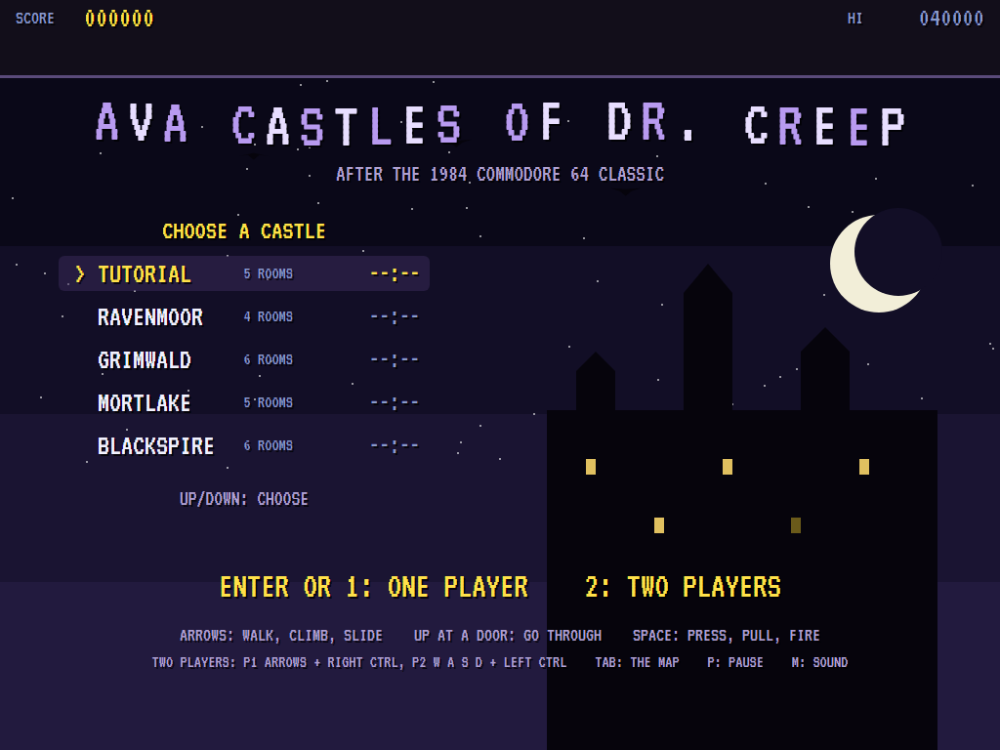 | 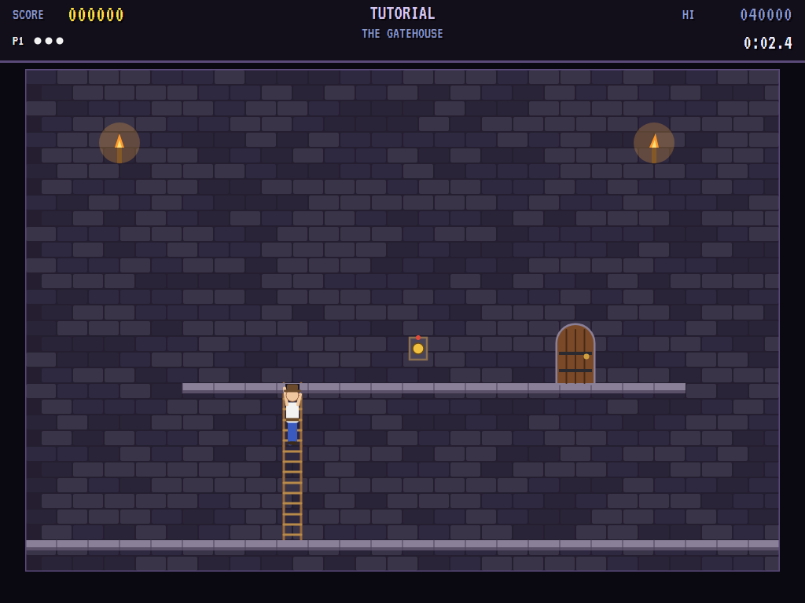 | 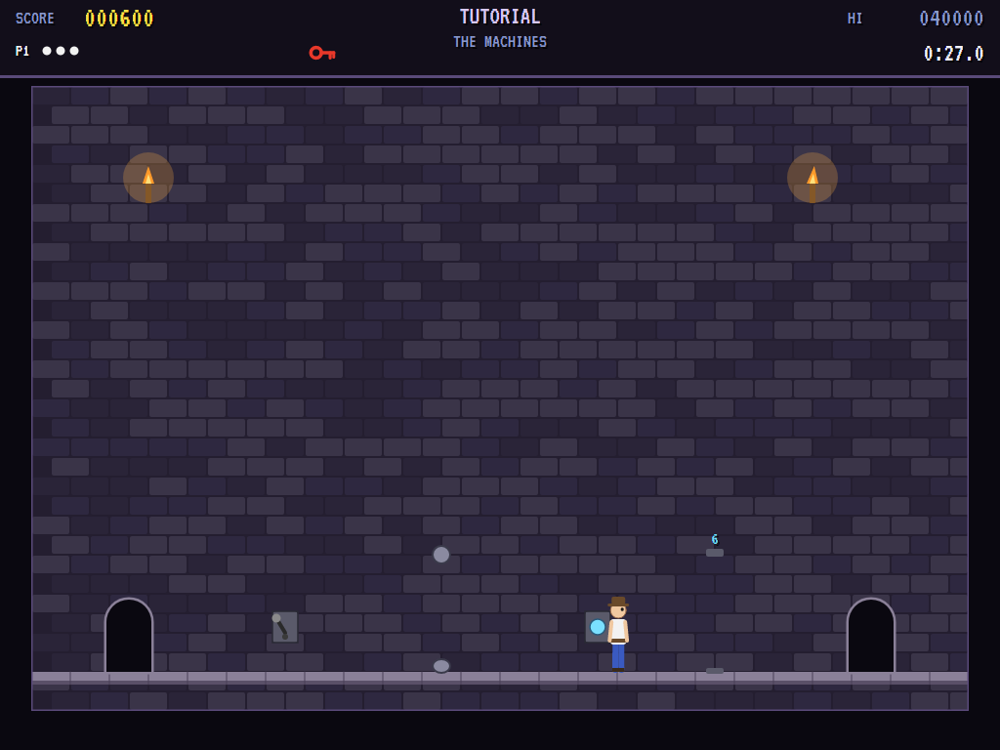 |
| Choose a castle. | Up the first ladder. | Lightning off, force field down. |

| The trapdoor | A mummy | The ray gun |
|:------------:|:-------:|:-----------:|
| 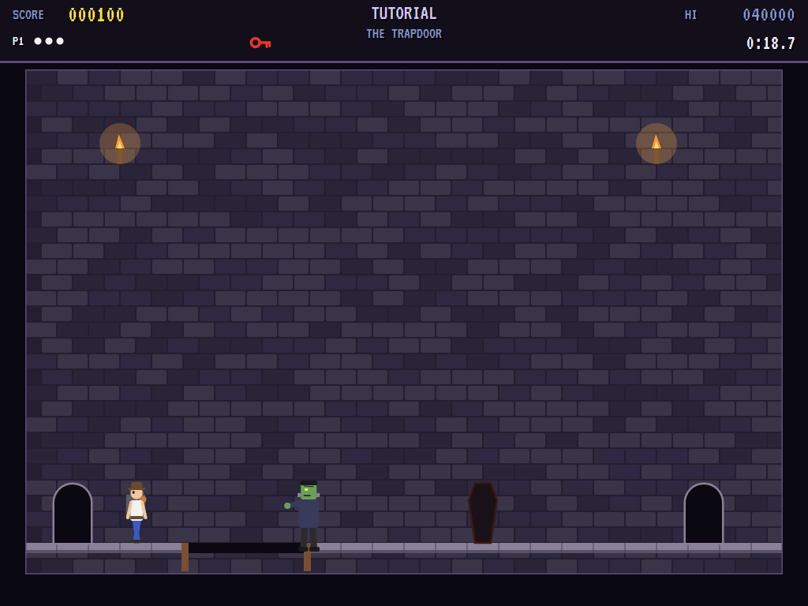 | 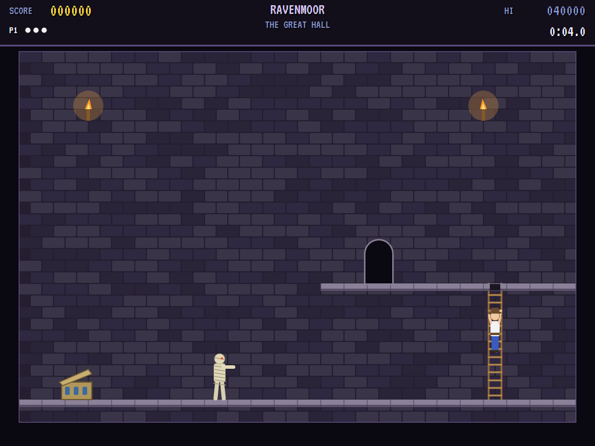 | 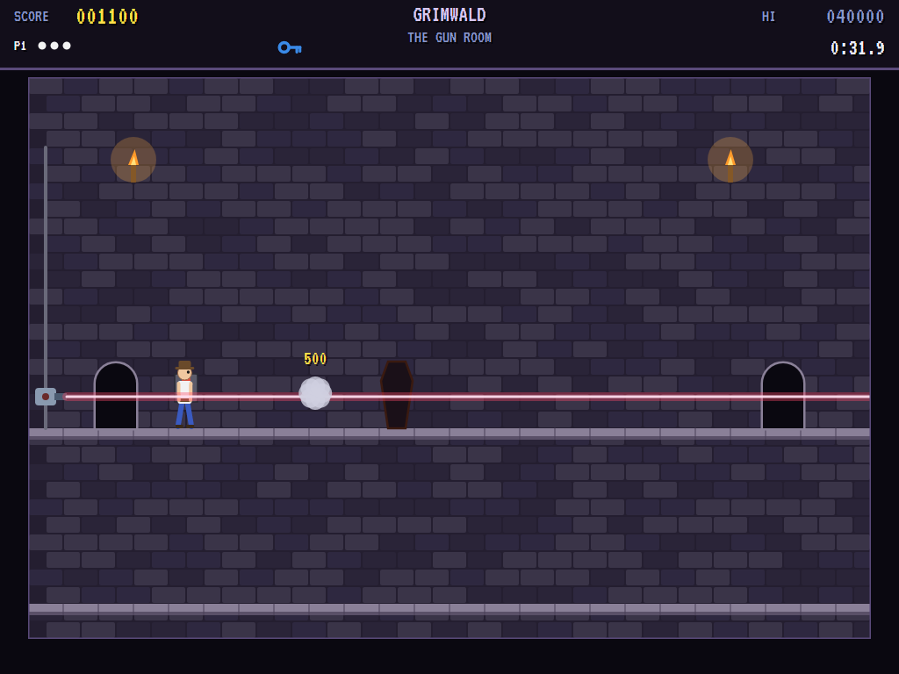 |
| The monster drops through. | On your heels in Ravenmoor. | Turned on the monster. |

| The ledge | The cellar | The laboratory |
|:---------:|:----------:|:--------------:|
| 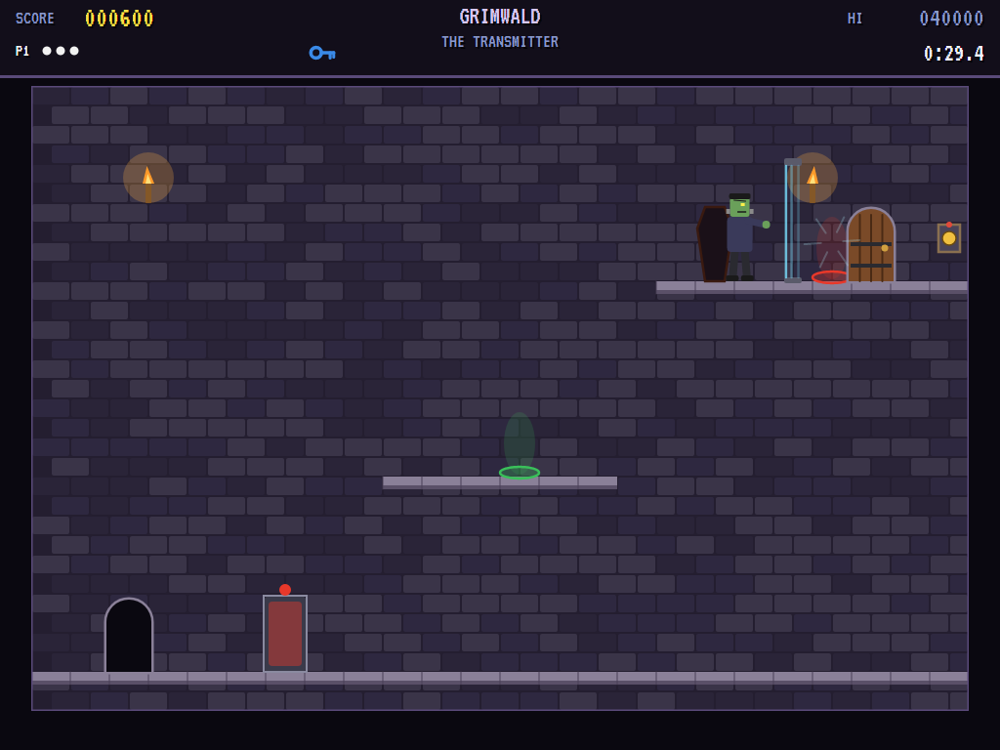 | 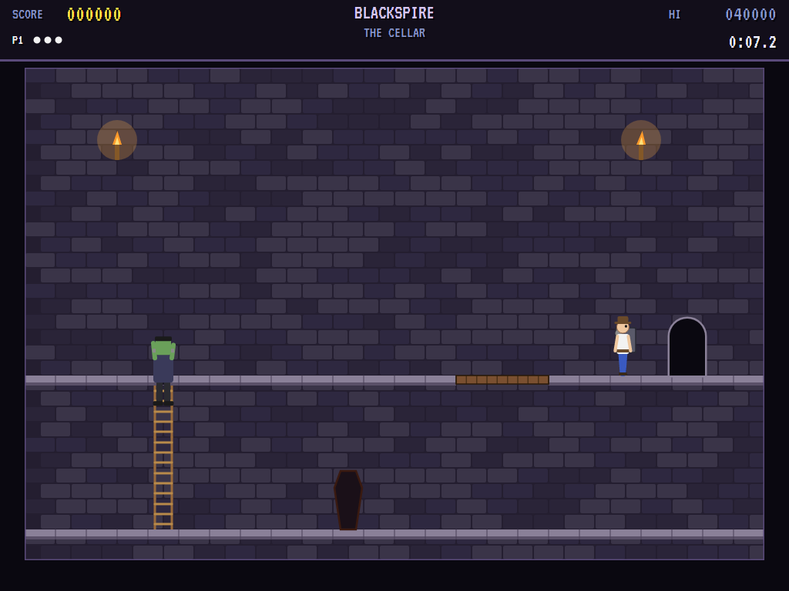 | 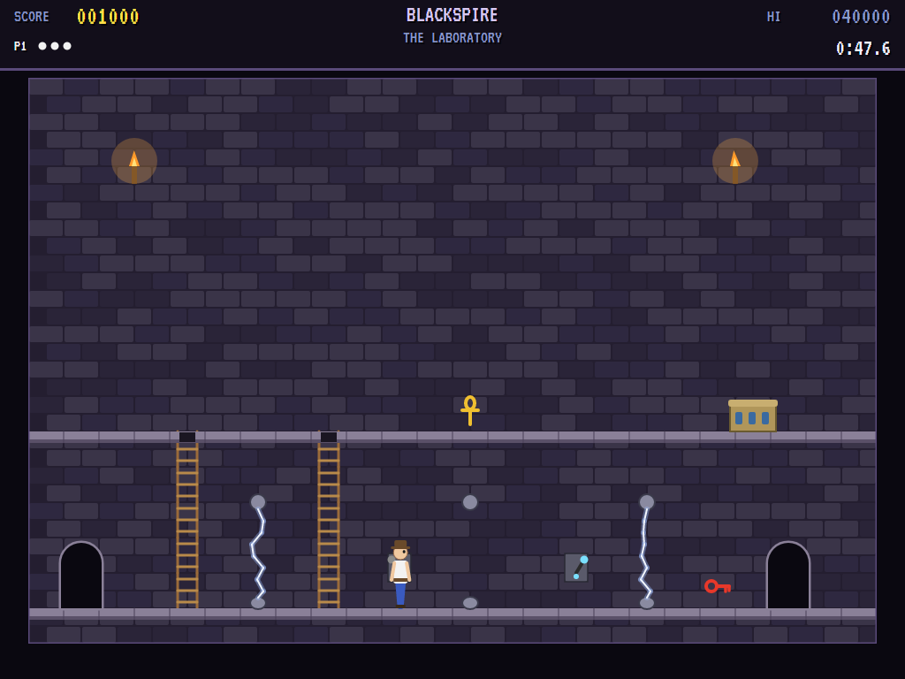 |
| A force field between you and the monster. | Blackspire: it's coming up the ladder. | Three lightning machines. |

| The map | Two players | Escaped |
|:-------:|:-----------:|:-------:|
| 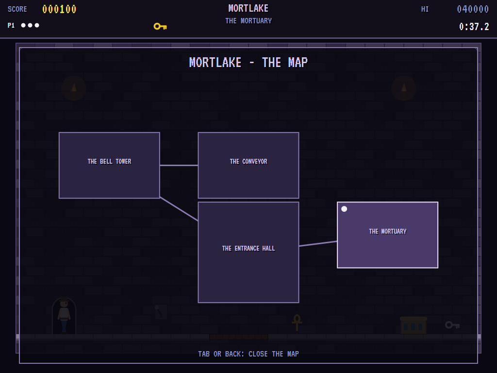 | 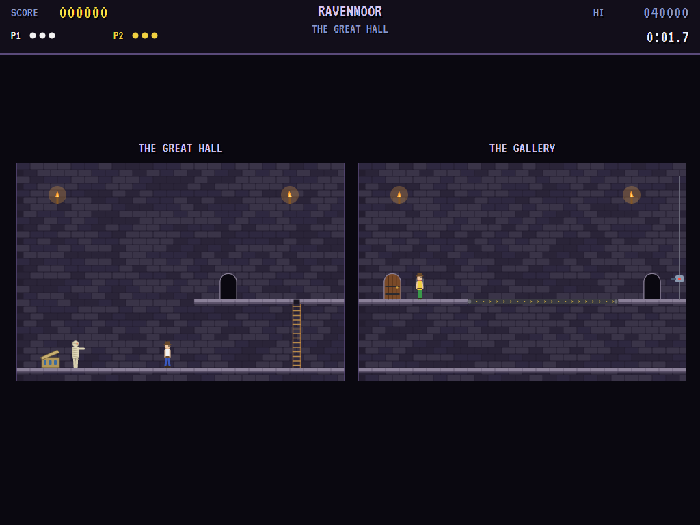 | 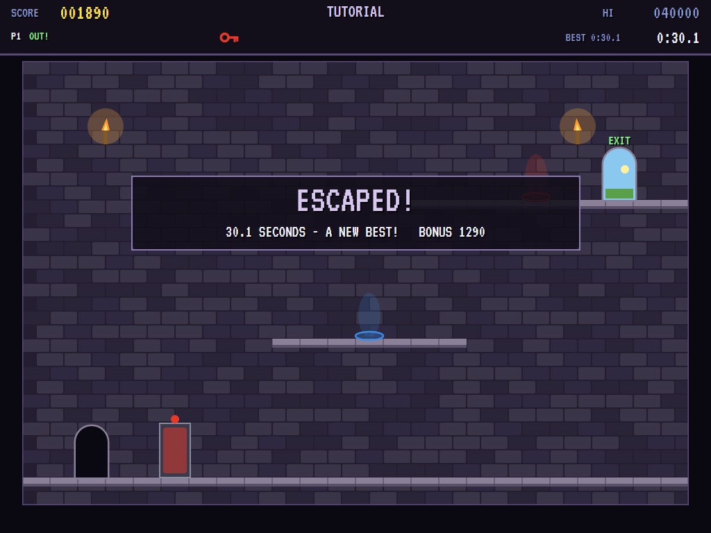 |
| Mortlake so far. | Apart, side by side. | Out, against the clock. |

The screenshots are made by the tests, which play the game in a real (headless) window; see
[Tests](#tests).

## Download and run

Ready-to-run builds for Windows, macOS and Linux, on both Intel/AMD and ARM, are on the
[Releases page](https://github.com/Harlock123/AVACastlesOfDrCreep/releases/tag/latest). **Latest build** is
rebuilt on every push to `main`. Each download is one self-contained executable: no .NET install is
needed.

| Platform | Archive |
|---|---|
| Windows | `AVACastlesOfDrCreep-win-x64.zip`, `AVACastlesOfDrCreep-win-x86.zip`, `AVACastlesOfDrCreep-win-arm64.zip` |
| macOS | `AVACastlesOfDrCreep-osx-arm64.tar.gz` (Apple silicon), `AVACastlesOfDrCreep-osx-x64.tar.gz` (Intel) |
| Linux | `AVACastlesOfDrCreep-linux-x64.tar.gz`, `AVACastlesOfDrCreep-linux-arm64.tar.gz`, `AVACastlesOfDrCreep-linux-arm.tar.gz` |

```bash
tar -xzf AVACastlesOfDrCreep-linux-x64.tar.gz     # or linux-arm64, linux-arm, osx-arm64, osx-x64
./AVACastlesOfDrCreep
```

On Windows, unzip and run `AVACastlesOfDrCreep.exe`. On macOS, if Gatekeeper refuses to open it, run
`xattr -d com.apple.quarantine AVACastlesOfDrCreep` once. Run with `--no-audio` for silence.

**Sound** comes through OpenAL Soft, built in for every platform. In a virtual machine the game
detects it and uses a larger audio buffer, so the sound doesn't break up.

**Gamepads** use SDL2, which is bundled for Windows, macOS and Intel/AMD Linux. ARM Linux builds need it
installed; without it the keyboard still works:

```bash
sudo apt install libsdl2-dev            # Debian / Ubuntu / Raspberry Pi OS
sudo pacman -S --needed sdl2-compat     # Arch / Omarchy
```

## Controls

| Action | One player | Two players: player 1 | Two players: player 2 | Gamepad |
|---|---|---|---|---|
| Choose a castle | Up and down | | | D-pad |
| Start | Enter or 1 | 2 | 2 | Start |
| Walk, climb, slide | Arrows or W A S D | Arrows | W A S D | Left stick / D-pad (pad 1, pad 2) |
| Go through a door, use a transmitter | Up | Up | W | Up |
| Press, pull, fire (at a control) | Space, Ctrl, Shift, Z or X | Right Ctrl, Right Shift or Enter | Space, Left Ctrl or Left Shift | A or B |
| The map | Tab | Tab | Tab | Back |
| Pause | P or Esc | | | Start |
| Sound on/off | M | | | |
| Screenshot | Ctrl+S (to your Pictures folder) | | | |

On the high-score table, type your initials, or use up/down and Space, then Enter.

## Tests

```bash
dotnet test AVACastlesOfDrCreep.slnx
```

The engine has no UI and runs in fixed 60 Hz steps, so it plays the same at any frame rate. The tests check:

- **The castles:** every one escaped by its written way out without a life lost, inside its target time,
  and with every monster it waits for actually coming; every door leading to a door that leads back; the
  tutorial and four castles in order
- **Moving about:** walking, kept inside the room; ladders up and down and poles only down; short falls
  survived and long ones not
- **The machines:** a shut door, its bell, and the door on the other side; locks and keys; trapdoors;
  walkways and their control; force fields and their button; lightning and its switch; a ray gun finding
  your height, and from its control yours to aim and fire; the transmitter's receivers
- **The monsters:** the ankh and the mummy on its floor; the monster waking, following by ladder, and
  dropping through a trapdoor
- **The game:** a lost life back at the door you came in by, and the last one ending the game; escaping,
  best times and on to the next castle; two players each with their own controls, both having to get out;
  the title's castle choice and one or two players; the attract mode and the high scores; initials; the keys
  for one player and for two

Castles are written as text in `src/AVACastlesOfDrCreep/Castles`. `tools/make_castles.py` builds them from
designs in code, so a new castle is a few lines of Python plus its way out:

```bash
python3 tools/make_castles.py
```

The screenshot tests draw the real screen in a headless window. To refresh the README's pictures:

```bash
DRCREEP_SHOTS=$PWD/Images dotnet test tests/AVACastlesOfDrCreep.Tests --filter ScreenshotTests
```

## Building

```bash
dotnet build AVACastlesOfDrCreep.slnx
dotnet run --project src/AVACastlesOfDrCreep
```

Needs the .NET 10 SDK. The sounds are made by `tools/make_sounds.py` (standard-library Python):
`python3 tools/make_sounds.py` rewrites `src/AVACastlesOfDrCreep/Sounds`. The spoken welcome needs
[espeak-ng](https://github.com/espeak-ng/espeak-ng) to remake (`sudo pacman -S espeak-ng`,
`sudo apt install espeak-ng`). Without it, the welcome already in the folder is left alone.

## Project structure

```
AVACastlesOfDrCreep/
├── AVACastlesOfDrCreep.slnx
├── src/AVACastlesOfDrCreep/
│   ├── Castles/                 # The castles, as text: rooms, things, and each one's way out
│   ├── Engine/
│   │   ├── GameEngine.cs        # States, the castle choice, one or two players, the title and demo
│   │   ├── GameEngine.Play.cs   # Moving about, doors, every machine and its control, the monsters, escaping
│   │   ├── Entities.cs          # Rooms, things, trapdoors and walkways, players and monsters; reading a castle
│   │   ├── RoutePilot.cs        # Walks a castle by its written way out (the demo, and the tests)
│   │   ├── CastleBook.cs, BestTimes.cs
│   │   ├── HighScoreTable.cs, InitialsEntry.cs
│   │   ├── InputHandler.cs, ControllerManager.cs  # Keys for one or two players, and two SDL2 gamepads
│   │   └── SoundManager.cs      # Effects, the welcome and the tunes through OpenAL
│   ├── Audio/                   # The OpenAL engine (from the author's AVABand)
│   ├── Views/                   # The drawing: rooms, machines, monsters, players, the map, the screens
│   └── Sounds/                  # The synthesised effects, tunes and the spoken welcome
├── tests/AVACastlesOfDrCreep.Tests/  # Castle, gameplay and screenshot tests
├── tools/make_castles.py, tools/make_sounds.py
└── Images/                      # Screenshots
```

## About and licence

AVA Castles of Dr. Creep © 2026 Lonnie Watson, under the [MIT License](LICENSE).

*The Castles of Dr. Creep* © 1984 Ed Hobbs and Brøderbund Software; the name belongs to its current owner.
AVA Castles of Dr. Creep is an independent, unofficial game in its style. Its castles, rooms and puzzles,
its graphics, sounds, tunes, the spoken welcome and the code are its own; nothing is taken from the original
game's program, castles, graphics or sound. It is not affiliated with or endorsed by any rights holder.
